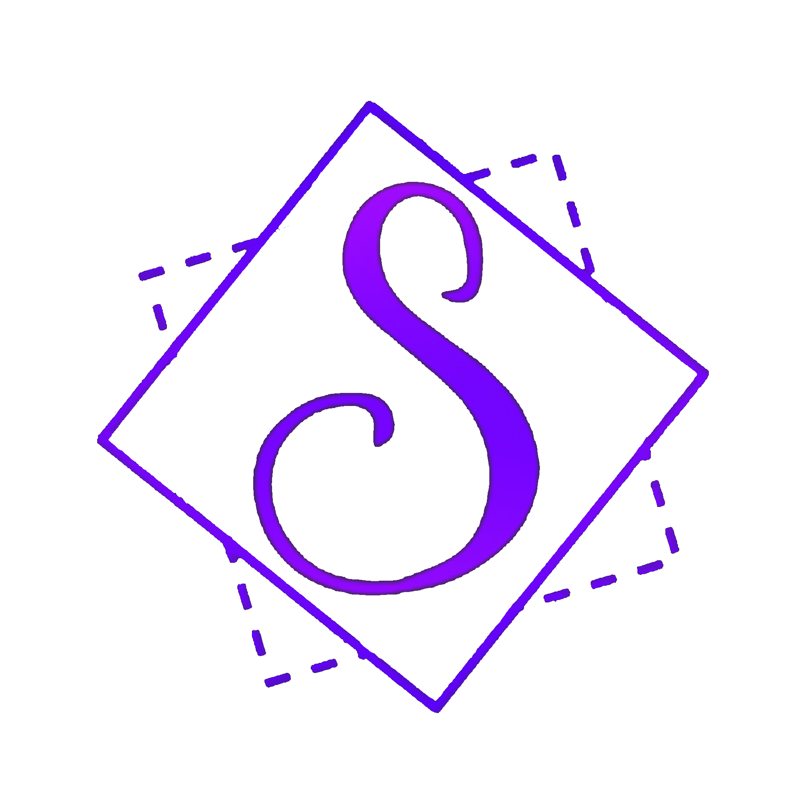

  

---

	
	
	

---

# Seralyth Menu  
Forked from ii's Stupid Menu

Seralyth Menu is a **feature-packed** mod menu for Gorilla Tag, built by the community, for the community. Whether you just want mods, are a developer, or anything inbetween, this menu has you covered. Designed to be **as useful as possible**, it includes a variety of features and options that let you customize your modding experience to your heart’s content.  

  
<b>💾 Installation</b>

	
1. **Download** the latest release **[here](https://github.com/recrewind/Seralyth/releases/latest)**
2. **Open and Install** `Seralyth-Menu.apk`
3. **Launch** nkhhi.gorillatag and enjoy!

---

  
<b>🔗 Headset Compatibility</b>

	
| Headset | Menu | Mods |
|---------|------|------|
|Oculus Go|⚠️|❌|
|Quest 1|❌|❌|
|Quest 2|✅|⚠️|
|Quest Pro|✅|✅|
|Quest 3/3s|✅|✅|
|Pico 4/Pro|❌|❌|

> ✅ Fully functional ; ⚠️ Limited functionality ; ❌ Not functionable ; ❓ Untested

  
<b>🗣️ Contact Information</b>

	
Join our [Discord](https://discord.gg/questmods)!

> [!NOTE] 
> This product is not affiliated with Gorilla Tag or Another Axiom LLC and is not endorsed or otherwise sponsored by Another Axiom LLC. Portions of the materials contained herein are property of Another Axiom LLC. © 2026 Another Axiom LLC. 

> This product is not affiliated with Another Axiom Inc. or its videogames Gorilla Tag and Orion Drift and is not endorsed or otherwise sponsored by Another Axiom. Portions of the materials contained herein are property of Another Axiom. ©2021 Another Axiom Inc.
